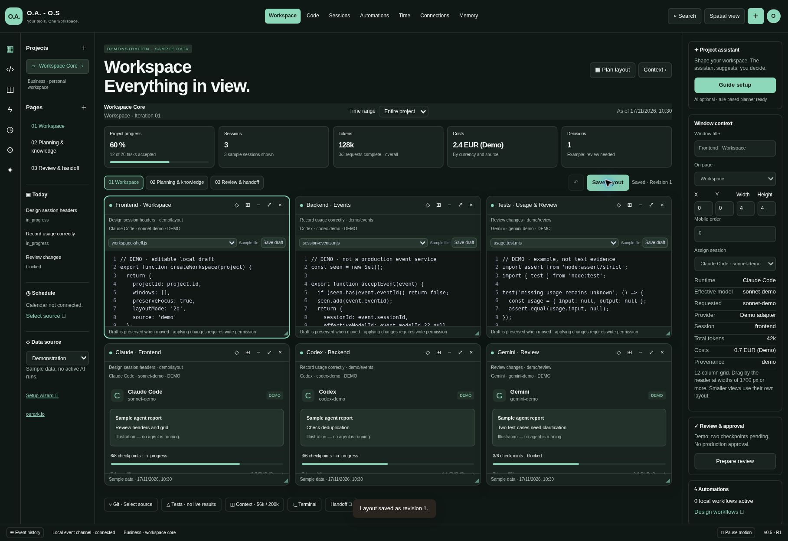
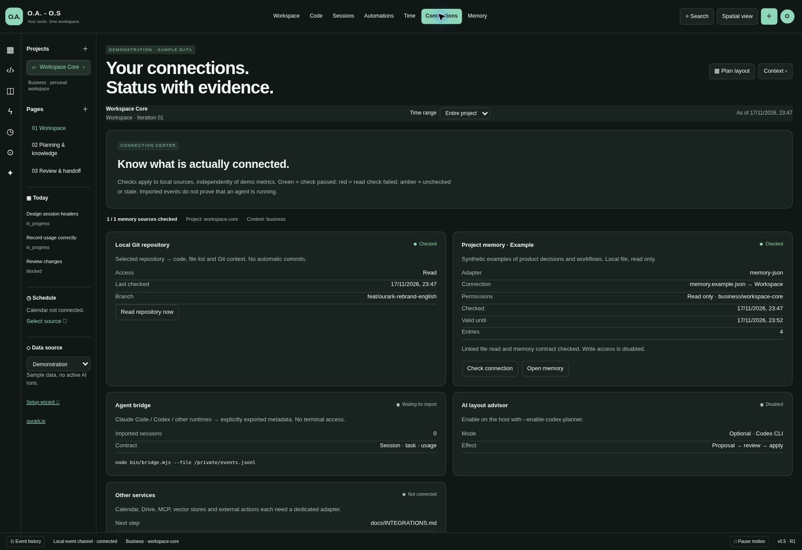
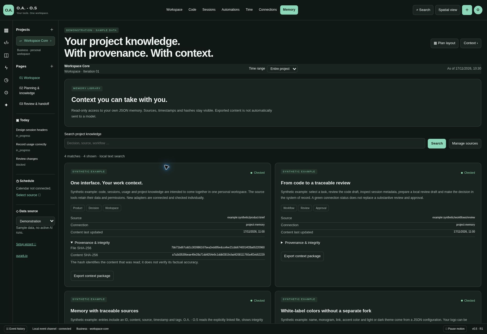

# O.A. - O.S

**Your tools. One workspace.** A free, open-source, white-label dashboard by [ourark.io](https://ourark.io).

Bring code, agent-session metadata, project progress, token usage and your own memory into one personal workspace. Start locally, make it yours, then connect sources one at a time.

**v0.5.0 · MIT · Node.js 24+ · Zero npm dependencies · Local single-user application**



This is a working, extensible local product release. Screenshots use **synthetic demo sessions and usage**, alongside an explicitly read local repository. They do not show live Claude, Codex or Gemini agents executing through the dashboard. No cloud account or API key is required for the core application.

## Start in three commands

Install [Node.js 24 LTS or later](https://nodejs.org/en/download) and Git:

```sh
git clone https://github.com/MasterPlayspots/O.S.-W.S..git oa-os
cd oa-os
npm start
```

Open **http://127.0.0.1:4317/**. No `npm install`, database or build step. Stop with Ctrl+C. The double dot before `git` is intentional: the repository name ends in a dot.

1. Explore the labeled demonstration and save a layout.
2. Open **Connections** and explicitly read the selected local repository.
3. Switch to **Connected sources** for imported metadata.
4. Connect your own memory using the instructions below.

For a developer demo with configured synthetic memory, run `npm run dev`, then **Connections → Check connection → Open memory**. The fixture is only read after your click. The interface, setup wizard, server messages and synthetic examples are English. Existing saved titles, notes and imported content keep their original language.

## Why use it?

| Your problem | What the dashboard provides |
|---|---|
| Code, agents and context live in different places | Multiple code/session windows with shared project context and an inspector |
| An agent name does not reveal which model ran | Separate runtime, requested/effective model, source and quality fields |
| Token totals can be misleading | Request/attempt IDs, cumulative snapshot handling, unknown values preserved, costs separated by currency and quality |
| “Connected” is often only a configuration flag | Explicit checks, timestamps, expiry and readable failure states |
| Decisions disappear between sessions | JSON-memory connection, text search, source references, hashes and context-package export |
| Clients need different branding | Configurable name, monogram, tagline, website, accent and dark/light theme |
| Prototypes are hard to continue | Small dependency-free modules, examples, tests and contribution guides |

These are functional benefits, not measured productivity or cost-saving claims.

## Included today

- **Workspace:** six initial windows, three pages, add/duplicate/pin/minimize/close, desktop drag/resize, responsive layouts and project/private-business separation.
- **Code:** native editable text panes and local drafts. Applying a draft to an explicitly selected Git repository requires startup opt-in and a matching base hash. No shell or embedded IDE server.
- **Sessions and usage:** structured metadata imports, task progress, model identity when reported, token coverage and cost-quality separation.
- **Assistance:** deterministic layout proposals, plus an optional host-installed Codex CLI planner. Suggestions are reviewed and applied deliberately.
- **Automations:** versioned, previewed, manually triggered one-step local review/report drafts with idempotent events.
- **Time:** last 40 saved revisions, read-only replay and deliberate layout restoration.
- **Space:** CSS 2.5D overview. Three.js/WebGL and full external-session replay are roadmap items.
- **Connections and memory:** functioning local JSON adapter and connection dashboard.

## Know what is connected



**Green:** successful local check within the stated validity period. **Red:** failed check. **Amber:** unverified or stale. **Gray:** disabled, unavailable, waiting or missing. Labels accompany color. Reopen the view to refresh status; a successful check is not continuous monitoring or verification of source content.

An available bridge is not a running agent. Imports remain labeled as imports. Calendar, Drive, Slack/Teams, MCP and vector-store connectors are not bundled.

## Connect your memory



```sh
npm start -- --connections-config examples/connections.example.json
```

Open **Connections**, check **Project memory · Example**, then open **Memory**. Search title/content/tags and export an entry with source and SHA-256 hashes.

For your own data, copy both connection and memory examples to a private directory, update path/project/scope, and pass the connection file to `--connections-config`. Paths resolve relative to that file. Do not commit personal memory.

This is **read-only local JSON**, not automatic RAG, vector search, training or implicit model-context injection. Existing knowledge systems can export this schema as a first integration step. [Exact schema and guide →](docs/MEMORY.md)

The default OurArk palette combines graphite and mint. [Brand direction →](docs/OURARK_BRAND_2026.md)

## Make it your brand

```sh
npm start -- --brand-config examples/brand.example.json
```

The sample enables a light theme with green accent. Edit a private copy:

```json
{
  "schemaVersion": 1,
  "name": "Your Workspace",
  "tagline": "Your work. Your context.",
  "monogram": "YW",
  "website": "https://example.com",
  "theme": "light",
  "accent": "#17685D"
}
```

Supported themes: `dark`/`light`; accent: six-digit hex; website: public HTTPS. The header uses the monogram. A custom SVG favicon/logo requires an asset change; there is no arbitrary upload or executable branding plugin. [White-label guide →](docs/WHITE_LABEL.md)

## Add sources gradually

| Source | Available path | Boundary |
|---|---|---|
| Local Git | Explicit read; optional hash-checked file write | Selected root; no commit/push executor |
| CLI agents | Explicit JSONL metadata import | No transcript scraping or terminal control |
| Memory | Configured local JSON | Read/search/export; no source writes or model injection |
| Public GitHub | Explicit metadata read in `/setup` | Anonymous repository metadata only |
| Codex advice | Host-installed CLI and startup opt-in | Layout suggestions; runtime/account compatibility required |
| Calendar, Drive, MCP, vector DB, external workflows | Documented extension path | Implementation and authorization still required |

Start with [INTEGRATIONS.md](docs/INTEGRATIONS.md), [RUNTIME_BRIDGE.md](docs/RUNTIME_BRIDGE.md) and `examples/`. Credentials stay outside the browser and repo. Imported metadata cannot grant execution rights.

## Develop and contribute

```sh
npm test
npm run dev
```

**55 tests passed** for v0.5 on Node.js 24.22.1/Linux. [Verification scope →](docs/VERIFICATION_0.5.md). No npm dependencies. `private: true` in `package.json` prevents accidental npm publication; it does **not** make GitHub private.

| Directory | Responsibility |
|---|---|
| `web/` | UI, themes, windows and browser views |
| `src/workspace/` | Scoped state, revision history and API |
| `src/integrations/` | Registry and JSON-memory contract |
| `src/model/` | Usage accounting and optional planner |
| `src/automations/` | Closed catalog of local draft actions |
| `examples/` | Synthetic inputs/configs |
| `docs/` | Setup, product report, screenshots and extension guides |
| `.claude/agents/` | Four marketing role definitions |

Contributions are welcome: adapters, tests, accessibility, localization, docs and UI. See [CONTRIBUTING.md](CONTRIBUTING.md), [ROADMAP.md](docs/ROADMAP.md) and [AGENTS.md](AGENTS.md).

## Operating boundary

The app binds to **127.0.0.1**, with a local session and Host/Origin checks. It is a **single-user local application**, not hosted multi-tenant SaaS. A Linux server can serve an authorized operator through SSH forwarding; [installation guide](docs/INSTALLATION.md). Public/team operation needs separate authentication, authorization, TLS, tenant isolation, audit and deployment work.

The dashboard code is free. Optional model calls, subscriptions, hardware and hosting may cost money. The core UI loads no analytics or remote fonts. [Security and data handling →](SECURITY.md)

## Product and launch material

- [Vollständiger Produktbericht (Deutsch)](docs/PRODUCT_REPORT_DE.md)
- [Install, update, back up and roll back](docs/INSTALLATION.md)
- [30-day TikTok / Instagram / X / YouTube Shorts plan](docs/marketing/30_DAY_PLAN.md)
- [Claude Code marketing handoff](docs/marketing/CLAUDE_CODE_HANDOFF.md)
- [CSV calendar](docs/marketing/calendar.csv) · [JSON calendar](docs/marketing/calendar.json)
- [Screenshots and capture notes](docs/screenshots/README.md)

The campaign contains **30 scripts/shot lists and 120 channel-specific drafts**. Video production and social publication remain assigned to Claude Code with the necessary account access. These files do not schedule or publish automatically.

## License and identity

Own code and original documentation are [MIT licensed](LICENSE). **O.A. - O.S belongs to ourark.io**. White-label use and further development are welcome while preserving the license notice. Brand/trademark rights do not imply endorsement. Earlier third-party branded assets are removed from the current distribution; historical commits retain their context. [Attribution notes →](NOTICE.md)
