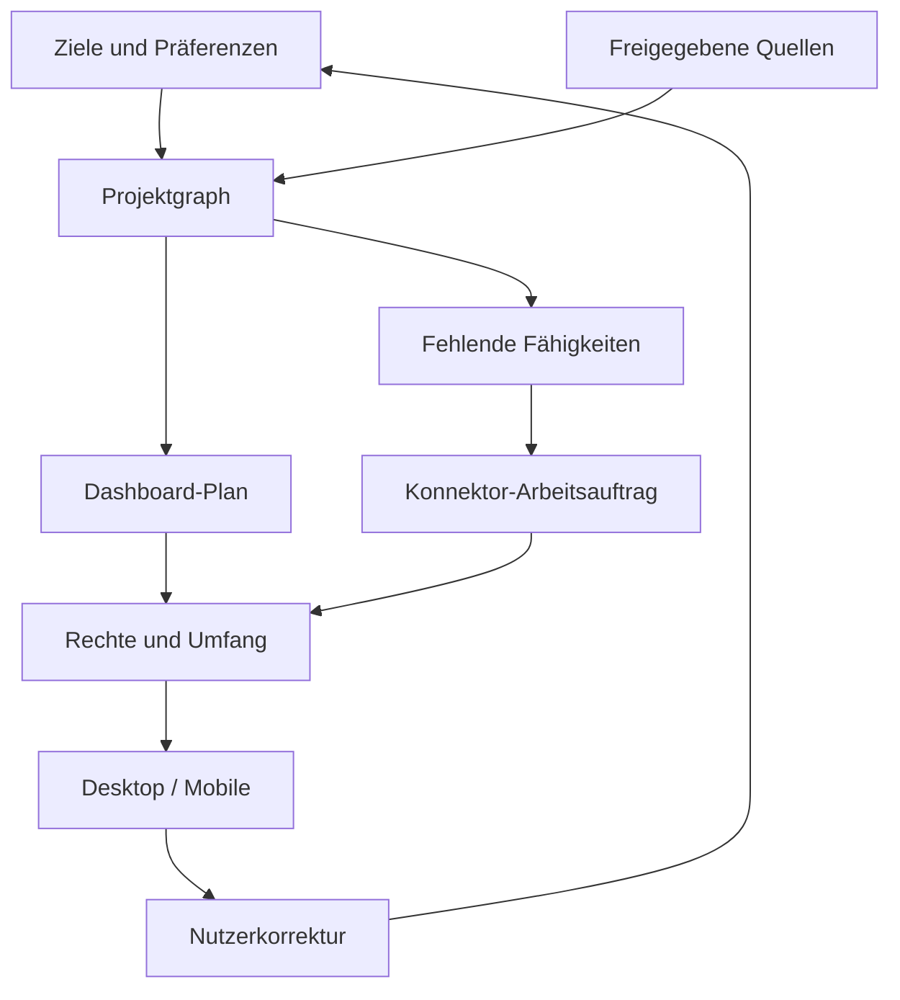

# Ein Arbeitsplatz, der sich begründet zusammensetzt

Produktentscheidung vom 17.11.2026. Diese Datei beschreibt die Zielarchitektur. Der tatsächliche Stand ist `STATE.md`.

Der Nutzer beschreibt das gewünschte Ergebnis. Das System erkennt ausschließlich freigegebene Quellen, ordnet deren Werte und Beziehungen ein und schlägt eine passende Arbeitsumgebung vor. Die Darstellung beginnt auf Makroebene: Ziel → Projekt → Aufgabe → benötigte Daten und Werkzeuge. Nutzer und Agenten erreichen Änderungen über dieselben typisierten Befehle.

## Meta-Ebenen

| Ebene | Inhalt | Reifegrad in 0.1 |
|---|---|---|
| Identität und Kontext | Nutzer, privat/geschäftlich, Projekt, Ressourcengrenzen | Projekt-/Scope-Abgleich in Eingaben; keine Serverauthentifizierung |
| Beobachtungen | Quelle, Zeitpunkt, Gültigkeit, Datenart, Umfang, Unsicherheit | Deklarierte Fähigkeiten mit Zeitfenster; lokale Projektmetadaten |
| Ontologie | Ziele, Aufgaben, Dienste, Daten, Beziehungen, Herkunft | Kleiner erzeugter Projekt-/Service-/DOT-Graph; keine Datenbank |
| Entscheidungsmodell | Nutzerpriorität, Aktualität, Eignung, Aufwand, Unterbrechungskosten | Deterministische Prioritäten-/Pin-/Sichtbarkeitsregeln |
| Policy | Welche Aktion an welcher Ressource innerhalb welcher Grenze? | Geschlossener Aktionskatalog ohne Executor |
| Komposition | Makro-/Detailansicht, Auswahl der DOTS, Desktop vs. Mobile | Plan mit Grid-/Stack-Views |
| Gestaltung | Form, Farbe, Glas, Tiefe, Zeit, Material, Motion | Parameter im Plan; einfacher schwarzer Renderer |
| Ausführung | Verbindung, Abfrage, Datei/Task-Aktion, Agentenarbeit | Noch nicht implementiert |
| Bewertung | Nutzerkorrektur, Ergebnisqualität, Fokus und Unterbrechungen | Journal im Plan; keine laufende Messung |

## Was „das System erkennen“ bedeutet

Entdeckung ist eine Reihe kleiner, erklärbarer Adapter: ausgewähltes Projekt → bekannte Dienste → vom Konto freigegebene Ressourcen → Datenprofile → Fähigkeiten. Das System darf aus einer gefundenen SDK-Abhängigkeit nicht auf ein angemeldetes Konto schließen. Ein Tokenname ist kein Recht. Ein Diagramm darf nicht Werte erfinden, wenn die Quelle fehlt.

Der erste Inspektor liest nur ein ausdrücklich angegebenes `package.json` und liefert Zählwerte sowie Modultyp. Spätere Adapter benötigen jeweils eigenen Scope, Herkunft und Aktualitätsnachweis. Aus Rohdaten werden möglichst Profile/Aggregate: Schema, Menge, Frequenz, Verfügbarkeit und Relevanz. Private Inhalte gelangen nicht automatisch an ein Modell.

## Dashboard-Komposition

1. Nutzerziel und nächsten Arbeitsschritt priorisieren.
2. Erforderliche Fähigkeiten bestimmen, beispielsweise Aufgaben lesen, Termine lesen, Dateien finden.
3. Vorhandene Fähigkeiten von Lücken, Anmeldung und veralteten Nachweisen unterscheiden.
4. Eine kleine Anzahl hilfreicher DOTS zeigen; weitere Funktionen bleiben in einer Seitenleiste erreichbar.
5. Jede Auswahl begründen und vom Nutzer korrigieren lassen.
6. Ein bestätigtes Layout versionieren. Während fokussierter Arbeit nur notwendige Daten aktualisieren, keine überraschende Umordnung.

Die gleiche Aufgabe kann auf dem Desktop mehrere nebeneinanderliegende Werkzeuge benötigen und mobil eine einzige primäre Handlung. Beide Views beziehen sich auf dieselben fachlichen Objekte, erhalten aber eigene Platzierungen.

## Fokus und Produktivität

Die Optimierung soll auf vom Nutzer gewählten Ergebnismaßen beruhen: Fertigstellung der ausgewählten Aufgabe, weniger unnötige Kontextwechsel, verständliche nächste Schritte und geringerer Korrekturaufwand. Mehr Bildschirmzeit, mehr Klicks oder mehr Agentenaktivität sind kein Erfolgskriterium.

Mögliche spätere Signale werden einzeln aktiviert und lokal aggregiert. Keine heimliche psychologische Profilbildung. Präferenzen sind explizit, erklärbar, exportierbar und zurücksetzbar. Ein Vergleich alternativer Boards erfolgt auf Wunsch und mit eigenen Erfolgskriterien. Eine universell höchste Produktivität kann das System nicht garantieren.

## Agentenrollen als Zielarchitektur

Ein Discovery-Agent sammelt freigegebene Metadaten. Ein Struktur-Agent baut den Projektgraphen. Ein Planungs-Agent schlägt Datenbindungen und DOTS vor. Ein Integrations-Agent untersucht Anschlusslücken. Ein Ausführungs-Agent arbeitet innerhalb verifizierter Rechte. Eine unabhängige Prüfung bewertet Wirkung und Rücknahme. Diese Rollen sind noch keine laufenden Prozesse.

Alle Rollen erhalten begrenzten Kontext, endliche Schritt-/Zeit-/Tokenbudgets und ein Ereignisjournal. Agentenausgaben sind Vorschläge; sie können nicht selbst ihre Rechte erhöhen oder eine unabhängige Freigabe ersetzen.
