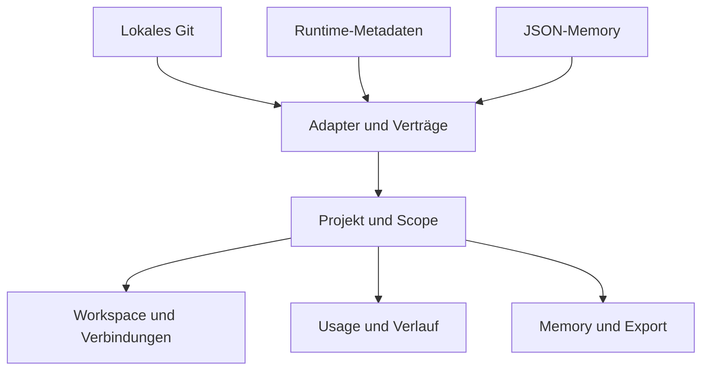

# Quellen und Adapter erweitern

Das Ziel ist eine zentrale Oberfläche mit nachvollziehbaren Quellen. v0.4 liefert lokale Git-Lesezugriffe, JSONL-Metadatenimport, JSON-Memory und optionalen Codex-Layoutvorschlag. Ein Plugin-Marktplatz oder universeller Cloud-Connector ist noch nicht implementiert.

## Schichten

Memory bleibt im begrenzten Prozesscache; Layouts, Entwürfe, importierte Metadaten und Revisionen werden im privaten Store gespeichert. Die Quellen behalten ihre Zuständigkeit. Schreibrechte entstehen niemals aus einer Statusmeldung.

## Implementierungsschritte für einen neuen Anschluss

1. Quelle, Eigentümer, Zweck, Datenminimierung, Projekt/Scope und notwendige Rechte festlegen. Zunächst read-only.
2. Adaptervertrag mit Schema-Version, erlaubten Feldern, Fähigkeiten, Quelle, Beobachtungszeit und Gültigkeit definieren. IDs stabil halten, unbekannte Werte `null` lassen.
3. Hostkonfiguration für exakt erlaubte Ziele erstellen. Keine browserseitigen freien URLs, Tokens oder Shellkommandos. Externe APIs brauchen Timeout, Größenlimits, Redirect-/Zielkontrolle und eingeschränkte Credentials.
4. Adapter als eigenes Modul ergänzen; Typ ausdrücklich in der Registry zulassen. Route nur für feste Operationen, nicht als beliebiges Netzwerk- oder Dateigateway.
5. `check` liefert Erfolg, Fehler oder ungeprüft mit Zeitstempel. Konfiguriert ist nicht verbunden. Erreichbar ist nicht autorisiert. Import vorhanden ist nicht laufender Prozess.
6. UI beschreibt Quelle → Ziel, Datentyp, Rechte, letzte Prüfung, Frische und Fehler. Keine gefälschten grünen Kacheln.
7. Tests für fremden Projekt-/Privatscope, unberechtigte Operationen, Fehler, veraltete Daten, Wiederholung und Größenlimits. Erster Browsernachweis ausschließlich mit geeigneten Testdaten.
8. Vertrag, Beispiel, Rückbau und Grenzen dokumentieren; dann realen Anschluss am autorisierten Host prüfen.

## Erweiterungspunkte

| Datei | Änderung |
|---|---|
| `src/integrations/registry.mjs` | aktuell Memory-Validierung und Quellenbindung; neuen Adaptertyp eng begrenzt ergänzen |
| `src/workspace/routes.mjs` | projektgebundene API und Integrationsstatus |
| `web/modules/integrations.js` | Statuskarten, Memory-Ansicht, Export |
| `web/modules/contracts.js` | gemeinsame validierte UI-/Eventverträge |
| `src/workspace/store.mjs` | versionierte Speicherung und Events |
| `src/model/usage.mjs` | Verbrauchsnormalisierung; Semantik erhalten |
| `test/integrations.test.mjs` | Negativfälle, Frische und Scope-Grenzen |

## Metadaten zuerst

CLI-Runtimes über [RUNTIME_BRIDGE.md](RUNTIME_BRIDGE.md) anschließen. Ein minimaler synthetischer Import liegt in `examples/runtime-events.example.jsonl`. Session zuerst, danach Usage/Tasks; Events sind pro Stream geordnet und wiederholbar. Die UI erhält keinen PTY-, Shell- oder Chatversandzugriff.

## Externe Aktionen als eigene Ausbaustufe

Ein späterer Executor benötigt Authentifizierung, Autorisierung je Operation, widerrufbare Rechte, Budget, Idempotenz, Audit, Abbruch und einen geprüften Rückweg. Der vorhandene Planer bzw. `actionDecision` ersetzt diese Kontrollen nicht. Automationsentwürfe sind heute lokal und manuell auslösbar; keine Cloudjobs oder stillen Deployments.
