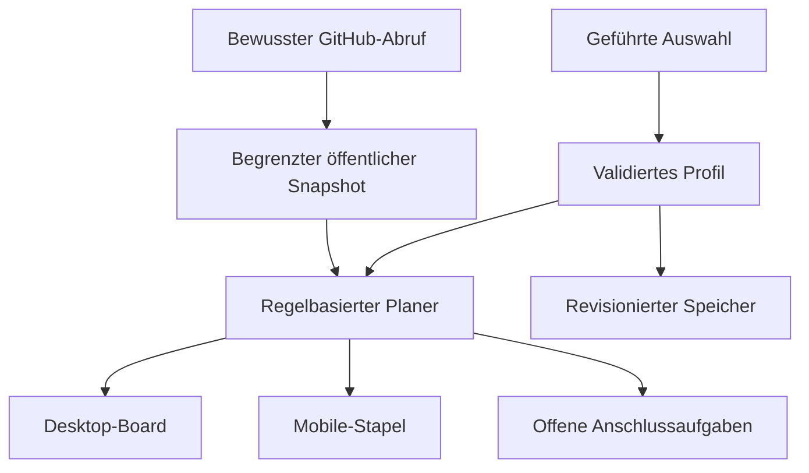

> **Aktueller Einstieg (0.3, 17.11.2026):** [UNIFORCE_INSTALL.md](UNIFORCE_INSTALL.md) und [WORKSPACE_ARCHITECTURE.md](WORKSPACE_ARCHITECTURE.md). Die folgenden Abschnitte beschreiben den weiterhin verfügbaren 0.2-Bootstrap unter `/setup`; neue Hauptoberfläche und Modell-/Bridge-Grenzen stehen in der 0.3-Dokumentation.

# Lokales Studio 0.2 · Vertrag und Grenzen

Stand 17.11.2026. Implementierung: `src/server.mjs`, `src/store.mjs`, `src/github.mjs`, `web/`, `bin/studio.mjs`.

## Datenfluss

Der Planer akzeptiert weiterhin deklarierte Inventare. Die lokale Anwendung projiziert ihren echten GitHub-Snapshot auf `project.metadata.read`; `declared_available` im Plan ist kein Authentifizierungsnachweis. `source.access`, `source.evidence`, `observedAt`, `expiresAt` und `sourceFresh` dokumentieren separat den vom Server durchgeführten anonymen Abruf. Ein vom Client behaupteter Snapshot wird nicht akzeptiert. Der Server hat keine allgemeine Tool-Ausführung.

## Lokale API

Alle API-Routen verlangen `x-oa-session` aus dem Meta-Element `oa-session` der lokalen Startseite. Der Wert wird pro Prozess erzeugt, nicht gespeichert oder in URLs eingebettet. Er darf nicht eingecheckt werden. Host und, falls vorhanden, Origin müssen exakt zur ausgegebenen Loopback-Adresse passen. Fremde Origins und `Sec-Fetch-Site: cross-site` werden zurückgewiesen. Kein CORS und keine frei konfigurierbare Bind-Adresse.

POST verlangt `Content-Type: application/json`, höchstens 32 KiB und nur die dokumentierten Felder.

| Methode / Pfad | Eingabe | Ergebnis / Wirkung |
|---|---|---|
| GET `/api/profile?project=ID&scope=business` | Projekt-ID, `private` oder `business` | Gespeichertes Profil, Revision und frisch berechneter Plan; leeres Profil hat Revision 0 |
| POST `/api/preview` | `{profile}` | Validierter Plan und vorhandener Snapshot; weder Speicherung noch GitHub-Abruf |
| POST `/api/profile` | `{profile, baseRevision}` | Atomare lokale Speicherung; bei abweichender Revision HTTP 409 und `currentRevision` |
| POST `/api/github` | `{project:{id,scope}, repository:"owner/name"}` | Ein anonymer öffentlicher GET oder ein frischer Cachetreffer; kein Schreibzugriff |

`profile` enthält ausschließlich `{preferences, repository}`. `repository` ist `null` oder ein validierter Name. Präferenzschema: `examples/preferences.json` und `validatePreferences` in `src/core.mjs`. Keine Credentials, freien Aktionsnamen oder Fremddatenfelder. Die API ist für spätere Agentenadapter nutzbar, aber kein MCP-Server.

## Speicherung

Dateiname ist SHA-256 von Scope und Projekt-ID; der Benutzerwert wird nie als Dateipfad verwendet. Die Datei enthält Revision, Profil und Zeitstempel. Pro Prozess werden Schreibvorgänge serialisiert. Neue Dateien entstehen mit Modus 0600, das Verzeichnis mit 0700; die Anwendung ersetzt das Profil über eine temporäre Datei und Rename. Ein Verzeichnis-Lock verhindert mehrere schreibende Prozesse im selben Speicher. Es gibt kein fsync-/Backup-Versprechen und keine vollständige Revisionshistorie.

Bei einem Konflikt bleibt der Browserentwurf erhalten. Erst exportieren, danach „Profil laden / neu beginnen“ wählen und Änderungen vergleichen. Kein automatisches Merge. Die Schaltfläche verwirft ungespeicherte Änderungen ausdrücklich; das aktive Profil wird darunter angezeigt.

Bei normalem Beenden wird der Lock entfernt. Nach einem harten Prozessabbruch bleibt `.local/profiles/.writer-lock` möglicherweise bestehen. Erst sicherstellen, dass alle Studio-Prozesse beendet sind, dann ausschließlich diesen Lock entfernen. Das Profil selbst nicht löschen. Die Anwendung überschreibt beschädigte Profile nicht stillschweigend.

Rücknahme einer Sitzung: Entwurf durch erneutes Laden verwerfen. Bereits gespeicherte Präferenzen manuell zurückstellen und neu speichern; JSON-Export dient als externe Kopie, ein Import-Button ist noch nicht implementiert. Lokale Profile sind keine Mehrbenutzer-Isolation und nicht verschlüsselt.

## Öffentlicher GitHub-Leser

Festes Ziel `https://api.github.com/repos/{owner}/{repo}`, Methode GET, API-Version 2026-03-10, kein Authorization-Header, keine Weiterleitungen, 8 Sekunden Timeout und maximal 256 KiB Antwort. Nur `public` und zum gewünschten Namen passende Antworten werden akzeptiert. Unbekannte Felder, Beschreibungen und Besitzerprofile werden verworfen. Der Adapter führt niemals Repository-Code aus.

Ausgabe: Repo-Name/-URL, Sichtbarkeit, Hauptbranch, Programmiersprache, Sterne, offene Issues **einschließlich PRs**, Archivstatus, letzter Push, Beobachtungszeit und Quelle. Eine Versionsverschiebung oder Umbenennung erfordert eine neue explizite Eingabe; Redirects werden nicht verfolgt.

Je Projekt/Scope/Repo gilt ein 15-Minuten-Cache. Höchstens zwei Abrufe gleichzeitig, pro Schlüssel 30 Sekunden Pause nach einem Versuch, maximal 100 Cache- und Versuchseinträge. Keine automatische GitHub-Aktualisierung. Ein lokaler Timer prüft nur die Aktualitätsanzeige. „Quelle lösen“ entfernt den Repo-Bezug aus dem Entwurf; nach Speichern auch aus dem Profil. Bereits gelesene öffentliche Metadaten können bis zum Prozessende bzw. Cache-Verdrängung im RAM liegen, werden aber ohne Bindung nicht mehr verwendet. Es existieren keine Kontoberechtigungen, die widerrufen werden müssten.

## Was daraus noch nicht folgt

Eine erkannte Sprache ist keine installierte Runtime, ein öffentlicher Repo-Zugriff keine Freigabe privater Repos und ein Anschlussauftrag kein laufender Agent. `model.execute` bleibt eine gewünschte Fähigkeit ohne Modellverbindung. Serverinstallation, zusätzliche Kontorechte, selbst geschriebene Konnektoren und externe Änderungen benötigen jeweils implementierte und geprüfte Ausführungspfade.
