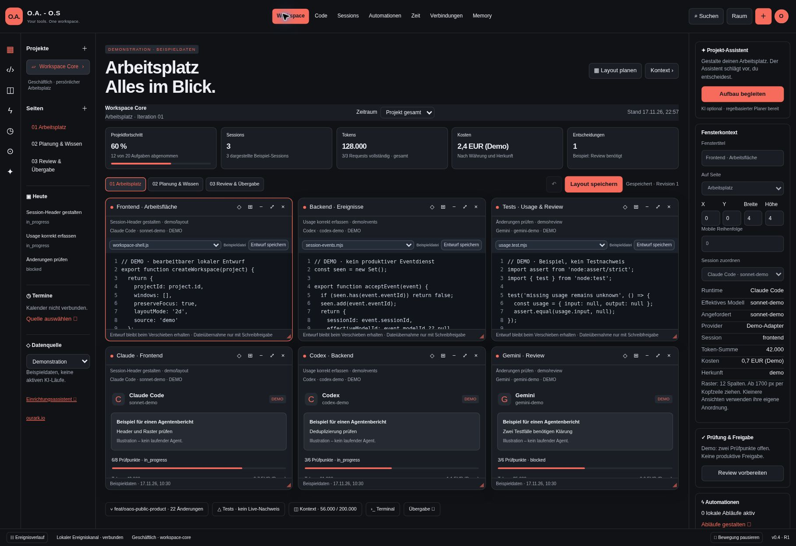
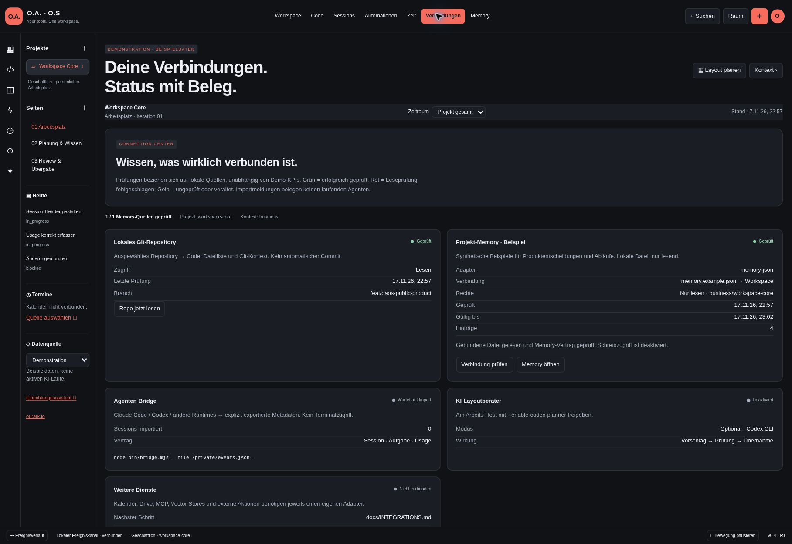
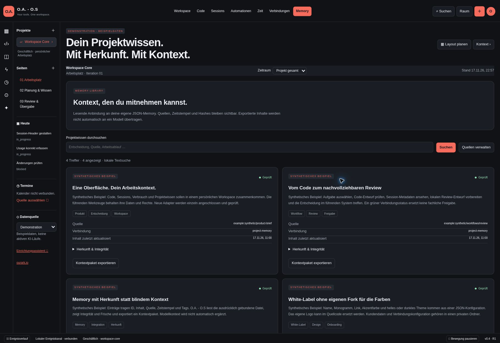

# O.A. - O.S — Produktbericht

**Produkt:** O.A. - O.S · **Zugehörigkeit:** ourark.io · **Release:** 0.4.0 · **Stand:** 17. November 2026

**Leitsatz: Deine Werkzeuge. Eine Arbeitsfläche.**

O.A. - O.S ist ein kostenloses, öffentliches und anpassbares Dashboard für Menschen, die mit Code, KI-Agenten und mehreren Wissensquellen arbeiten. Die Anwendung ordnet Arbeitsfenster, Sessions, Projektfortschritt, Verbrauch und angebundene Memory in einer gemeinsamen Oberfläche. Sie startet lokal ohne npm-Abhängigkeiten oder Datenbank und lässt sich gezielt erweitern.

Das vorliegende Projekt ist als lauffähige, dokumentierte lokale Version mit Tests, Beispielen und echten Screenshots aufbereitet. „Fertig“ bezieht sich auf diesen abgegrenzten Release. Eine universelle Verbindung zu allen Diensten, Mehrbenutzer-SaaS und autonom ausgeführte externe Prozesse sind weitere Entwicklungsschritte.

## 1. Ausgangsproblem und Nutzen

KI-Arbeit verteilt sich häufig auf Editor, Terminal, Chat, Repository, Dokumente und separate Agentenläufe. Dabei gehen nicht nur Fenster verloren: Es wird unklar, welcher Lauf zu welcher Aufgabe gehört, welches Modell tatsächlich verwendet wurde, welcher Verbrauch bekannt ist und ob das verfügbare Wissen aktuell ist.

O.A. - O.S schafft dafür eine persönliche gemeinsame Arbeitsfläche. Der Nutzer kann Code und Sessioninformationen nebeneinander betrachten, den Kontext eines Fensters ansehen, die nächste Aufgabe zuordnen, den Zustand einer Quelle prüfen und relevantes Wissen gezielt mitnehmen. Die führenden Werkzeuge behalten dabei ihre Zuständigkeit.

| Vorteil | Konkreter Mechanismus | Praktischer Nutzen |
|---|---|---|
| Übersicht | mehrere stabile Fenster, Seiten und Kontextinspector | weniger Suche nach dem zur Aufgabe passenden Kontext |
| Nachvollziehbarkeit | Runtime, Modell, Quelle, Qualität und Beobachtungszeit getrennt | Demo, importierte Meldung und bestätigter Lauf werden unterscheidbar |
| Verbrauchstransparenz | Requests/Attempts, Snapshot-Semantik, Abdeckung, getrennte Kosten | fehlende Zahlen werden nicht als Null oder geratenes Budget dargestellt |
| Verständliche Integrationen | eigene Verbindungsansicht mit Status und Rechten | sichtbar, was angebunden ist, wie es fließt und was noch fehlt |
| Nutzbares Projektwissen | JSON-Memory, Suche, Herkunft, Hashes, Export | Entscheidungen können bewusst zwischen Arbeitsschritten weitergegeben werden |
| Anpassbarkeit | eigene Markenparameter ohne Änderung der Geschäftslogik | Einstieg für eigene Produkte und kundenspezifische Arbeitsplätze |
| Weiterentwickelbarkeit | kleine Module, explizite Verträge und 54 Tests | neue Quellen können schrittweise ergänzt und geprüft werden |

Zeitersparnis, weniger Kontextwechsel und bessere Entscheidungen sind plausible Nutzenhypothesen. Es liegen noch keine Messungen vor, die Prozentwerte, ROI oder allgemeine Leistungsversprechen rechtfertigen.

## 2. Für wen das Produkt gedacht ist

**Einzelentwickler und technische Gründer** erhalten eine gemeinsame Sicht auf eigene Codearbeit, Agentenmetadaten und Wissen. **Agenturen und interne Toolbuilder** können die Oberfläche unter eigener Marke weiterentwickeln. **Kleine Projektteams** können gemeinsame Datenverträge und Abläufe aufbauen; gleichzeitiger Mehrbenutzerbetrieb ist jedoch noch keine gelieferte Fähigkeit. **Technikaffine Anwender** können ohne Cloudkonto mit der Demo starten und lokale Quellen ergänzen.

Für vollständig nichttechnische Nutzer bleibt die Erstkonfiguration eigener Quellen derzeit eine Hürde: JSON-Dateien und Startargumente sind einfacher als eine vollständige Integrationsentwicklung, aber kein universeller Ein-Klick-Assistent. Die mitgelieferten Beispiele und Zuordnungstabellen verkürzen den Einstieg; eine spätere geführte Konfiguration ist sinnvoll.

## 3. Die Arbeitsoberfläche

Das Hauptdashboard beginnt mit drei Codefenstern und drei zugehörigen Sessionfenstern. Die Fensterköpfe zeigen Aufgabe, Branch und Runtime-/Modellbezug, soweit gemeldet. Oberhalb stehen Projektfortschritt, Sessions, Tokens, Kosten und Entscheidungen. Links liegen Projektkontext und Seiten, rechts der Inspector und die Assistenz. Weitere Ansichten bieten Code, Sessions, Automationen, Zeit, Verbindungen und Memory.

Fenster können ergänzt, dupliziert, angeheftet, minimiert oder geschlossen werden. Desktopgrößen unterstützen Rasterposition und Größe; kleinere Ansichten nutzen eigene Anordnung. Das Layout wird als Revision gespeichert. Ein Pin schützt vor automatischer Umordnung. Entwürfe sollen beim Wechsel der Darstellung erhalten bleiben.

Der Codebereich verwendet native Textfelder. Er bietet Datei-/Entwurfsarbeit, aber keinen vollständigen Monaco-/VS-Code-Ersatz und kein Terminal. Die Sessionansicht ist eine Darstellung strukturierter Informationen, kein eingebetteter Chatclient. Ein geschlossenes Sessionfenster beendet keinen externen Prozess.

## 4. Unterstützung und Orchestrierung

Die erste Assistenzstufe arbeitet regelbasiert: Sie schlägt innerhalb eines validierten Rasters eine ausgewogene oder fokussierte Anordnung vor. Ein optionaler Codex-CLI-Anschluss kann diese Wahl anhand eines formulierten Arbeitsziels unterstützen. Der Nutzer prüft den Vorschlag, übernimmt ihn und speichert getrennt. Ohne Modellanschluss bleibt der regelbasierte Ablauf nutzbar.

Orchestrierung bedeutet im aktuellen Release: Aufgaben, Fenster, Datenquellen und lokale Entwurfsabläufe nachvollziehbar zusammenführen. Die Anwendung führt keine beliebigen externen Agentenketten, Deployments oder Nachrichtenversände aus. Der Aktionskatalog ist bewusst geschlossen.

Automationen besitzen Version, Auslöser, Zustand und einen lokalen Schritt. Vor Aktivierung wird die Wirkung geprüft. Ein manuelles Ereignis kann anschließend einen Review- oder Berichtsentwurf erzeugen. Wiederholt man dieselbe Ereignis-ID, entsteht kein zweiter Entwurf. Produktive Freigaben verbleiben im führenden System.

## 5. Modelle, Tokens und Kosten

Ein Runtime-Name wie Claude Code oder Codex ist nicht gleichbedeutend mit einer bestimmten Modellversion. Deshalb werden Runtime, Provider, angefordertes Modell und effektives Modell getrennt geführt. Fehlende Angaben bleiben unbekannt. Gleiches gilt für Kontextbelegung und Kosten.

Verbrauch wird pro Request und Versuch normalisiert. Kumulative Snapshots ersetzen ältere Stände, statt sich versehentlich zu addieren. Deltas benötigen eine passende Basis und fortlaufende Revision. Provider-Gesamtsummen haben Vorrang; Input plus Output wird nur bei passender Semantik gebildet. Cache- und Reasoning-Teilwerte werden nicht nochmals auf die Gesamtsumme geschlagen. Teilweise fehlende Daten bleiben als unvollständige Abdeckung sichtbar.

Kosten sind nach Währung und Herkunft getrennt. Ein abonnierter CLI-Zugang liefert nicht automatisch korrekte Requestkosten. Das Produkt behauptet deshalb weder kostenlose Modellaufrufe noch einen vollständigen Abrechnungsnachweis.

## 6. Verbindungsmatrix als eigener Arbeitsbereich

Die Verbindungsansicht erklärt Quelle, Ziel, Adapter, Rechte und letzte Prüfung. Eine erfolgreiche Prüfung wird grün angezeigt, ein Fehler rot, ungeprüfte/veraltete Werte gelb und fehlende oder deaktivierte Fähigkeiten grau. Textlabels ergänzen die Farben.

Eine Konfiguration ist noch kein erfolgreicher Anschluss. Eine erreichbare Bridge ist noch kein laufender Agent. Importierte Sessions bleiben importierte Meldungen. Die Prüfung ist zeitlich begrenzt; beim erneuten Abruf wird Frische berechnet. Es gibt keine kontinuierliche externe Überwachung.

Für eine neue Umgebung entsteht so eine nachvollziehbare Reihenfolge: lokale Oberfläche starten, ausgewähltes Repository lesen, Memory binden, Metadaten importieren und erst danach weitere Adapter ergänzen. Jede grüne Anzeige braucht eine tatsächliche Prüfung; nicht verfügbare Systeme werden nicht als verbunden inszeniert.

## 7. Memory als mitnehmbarer Kontext

Der erste produktive Anschluss ist eine explizit konfigurierte lokale JSON-Datei. Einträge tragen ID, Titel, Inhalt, Quelle, Aktualisierungszeit und Tags. Nach einem erfolgreichen Check kann der Nutzer sie lesen, per Textsuche finden und einzeln als Kontextpaket exportieren. Das Paket enthält Herkunft, Projektkontext und Hashes.

Dies ermöglicht eine einfache Brücke zu vorhandenen Wissensbeständen: Ein externes System kann einen minimierten Export im dokumentierten Format erzeugen. Ein solcher Exporter ist separat zu implementieren; Drive, REA, Obsidian oder ein Vector Store sind nicht schon automatisch verbunden.

Memory wird nur gelesen. Es gibt keine automatische Übertragung an ein Modell, keine Embeddings, kein Training und keine semantische Suche. Inhalte gelten als Daten, nicht als neue Agentenbefehle. Hashes helfen, einen konkreten gelesenen Stand wiederzuerkennen; sie beweisen nicht, dass eine Aussage stimmt. Quellen mit `example:` sind ausdrücklich synthetisch gekennzeichnet.

## 8. White-Label und Gestaltung

Die Standardidentität lautet exakt **O.A. - O.S**, zugehörig zu **ourark.io**. Graphit, weiße Typografie und korallenfarbene Akzente bestimmen die Oberfläche. Das neue O.A.-Monogramm ist ein eigenes Asset; frühere Drittmarkenassets gehören nicht zur aktuellen Auslieferung.

Name, Monogramm, Tagline, Website, Akzent und Hell-/Dunkel-Theme lassen sich über eine JSON-Datei ändern. Ein individuelles Bildlogo kann im Source-Asset ersetzt werden. Beliebige HTML-/JS-/CSS-Injektionen oder Uploadplugins sind nicht Teil der Konfiguration. Der Legacy-Einrichtungsassistent `/setup` bleibt separat und wird nicht vollständig mitgestaltet.

Die MIT-Lizenz erlaubt Anpassung und Weiterentwicklung unter Erhalt des Lizenzhinweises. Die Markenidentität ist davon zu unterscheiden: Ein Fork soll keine offizielle Zugehörigkeit oder Empfehlung behaupten, die nicht besteht.

## 9. Architektur und Betriebsmodell

Die Anwendung besteht aus einem Node.js-HTTP-Server, einer nativen Browseroberfläche, validierten Verträgen und einem lokalen Dateispeicher. Sie benötigt keine npm-Abhängigkeiten, keinen Datenbankdienst und keinen Frontendbuild. Dadurch ist der Einstieg überschaubar und der Quellcode direkt prüfbar.

Die Kernschichten sind UI/Fenstermanager, Workspace/API/Store, Quellenadapter, Usage und lokale Automationen. Projekt-ID und Privat-/Geschäftlich-Scope trennen Arbeitskontexte. Revisionen verhindern stilles Überschreiben konkurrierender Änderungen. Der Verlauf behält die letzten 40 gespeicherten Zustände. Dies ist weder ein unbegrenztes Archiv noch ein vollständiger Replay aller externen Dateien und Chats.

Der Server bindet an 127.0.0.1 und verwendet eine lokale Sitzung sowie Host-/Origin-Prüfungen. Das unterstützte Modell ist ein einzelner berechtigter Nutzer auf einem vertrauenswürdigen Host. Für einen Linux-Server ist ein privater SSH-Zugang mit Portweiterleitung dokumentiert. Internetfähiges SaaS, Rollenverwaltung und Mandantentrennung brauchen eigene Umsetzung und Prüfung.

## 10. Typische Arbeitsprozesse

| Prozess | Ablauf | Ergebnis |
|---|---|---|
| Projektstart | Kontext wählen → Demo verstehen → Layout anpassen/speichern → Quellen prüfen | eigener übersichtlicher Arbeitsplatz |
| Entwicklungsaufgabe | Repo lesen → passende Datei öffnen → Entwurf bearbeiten → Session-/Aufgabenmetadaten daneben ansehen | nachvollziehbarer lokaler Entwurf |
| Review | Aufgabe prüfen → Automationswirkung ansehen → lokalen Reviewentwurf erzeugen → Entscheidung im führenden System | vorbereitete Übergabe ohne heimliche Freigabe |
| Wissen nutzen | Memory prüfen → Begriff suchen → Quelle/Stand ansehen → Kontextpaket exportieren | ausgewähltes Wissen mit Herkunft |
| Neuer Dienst | Vertrag definieren → read-only Adapter → Fehler-/Scope-Tests → Statuskarte → Host-Abnahme | begrenzter und prüfbarer Anschluss |
| Kundenvariante | eigene Brand-Konfiguration → private Quellenkonfiguration → separate Profile → Abnahme | angepasster Einzelarbeitsplatz |

## 11. Grenzen, Risiken und nächste Ausbauschritte

Die größte Produktlücke ist die begrenzte Zahl fertiger Adapter. Der Mehrwert wächst mit zuverlässigen Quellen; ein hübsches Dashboard ohne diese Daten ersetzt keine Integration. Als nächste Schritte bieten sich ein geführter Verbindungsassistent, ein erster tatsächlich benötigter read-only Cloudadapter und bessere Agentenmetadatenexporter an.

Ein weiteres Risiko sind missverständliche Statusmeldungen. Deshalb dürfen Monitoring, Modellkosten und Produktfortschritt nur aus passenden Quellen stammen. Datenqualität und Frische müssen auch bei Erweiterungen sichtbar bleiben. Für echte Agentenausführung braucht es eine separate Kontrollschicht mit Rechten, Budgets, Audit und Abbruch.

Responsive CSS und reduzierte Bewegung sind vorhanden. Der aktuelle Release-Nachweis deckt Desktopinteraktionen ab; ein vollständiger Test auf echten Mobilgeräten und ein Accessibility-Audit bleiben offen. Die Raumansicht ist CSS 2.5D, keine Three.js-Engine. Ein 3D-/Zeitmodell muss Interaktion, Lesbarkeit, Performance und zugängliche 2D-Alternativen ausdrücklich erhalten.

## 12. Qualität und Lieferumfang

Für diesen Stand bestehen 54 Tests auf Node.js 24.22.1/Linux. Sie prüfen unter anderem getrennte Kontexte, Revisionkonflikte, geordnete/idempotente Events, Tokenaggregation, optionale Dateiübernahme, beschränkte Modellplanung und neue Memory-/Branding-Verträge. Im Browser wurden Layoutspeicherung und Neuladen, explizites Repo-/Memory-Lesen, Suche und Kontextdownload geprüft. Drei echte Screenshots liegen unter `docs/screenshots/`.

Der Code wird mit README, MIT-Lizenz, Installationsanleitung, Integrations-/Memory-/Branding-Verträgen, Beitragsregeln, Roadmap und Claude-Code-Handoff geliefert. Vorhandene Git-Historie bleibt erhalten. Ein Mustercheck auf erkennbare Secrets ersetzt keinen vollständigen Audit; ein früher erwähnter Schlüssel ist durch diesen Release nicht als widerrufen oder vollständig aus jeder Historie entfernt nachgewiesen.

## 13. Veröffentlichung und Marketing

Die Positionierung lautet: ein freies, lokales Dashboard als gemeinsame Arbeitsfläche für Code, Sessions, Verbrauch und Memory — anpassbar und offen für Beiträge. Die Kampagne erklärt zuerst den konkreten Arbeitsalltag, zeigt dann belegte Funktionen und lädt anschließend zur eigenen Nutzung und Erweiterung ein.

Der 30-Tage-Plan enthält 30 Hooks, kurze gesprochene Skripte, Shotlists, Handlungsaufforderungen und insgesamt 120 kanalbezogene Texte für TikTok, Instagram, X und YouTube Shorts. CSV/JSON sowie ein separates Publishing-Log ermöglichen die Weiterverarbeitung. Öffentliche Captions sind auf Englisch; Steuerung und Handoff sind auf Deutsch.

Vier projektspezifische Claude-Code-Rollen sind vorbereitet: Produktrecherche, Contentproduktion, Claim-Prüfung und Growth-Analyse. Ihre Dateien liegen direkt im Repo. Ein externes MIT-Marketing-Skillpaket ist zusätzlich recherchiert und mit reproduzierbarem optionalem Installationsweg dokumentiert. Es wurde nicht installiert oder ausgeführt.

Claude Code soll die belegten Funktionen als Screenrecordings aufnehmen, Videos/Untertitel/Cover produzieren und anhand tatsächlich verfügbarer Social-Konten veröffentlichen. Der aktuelle Lieferstand enthält Entwürfe, keine gerenderten Videos, terminierten Posts oder erfundenen Reichweiten. Ein Produktions- und Veröffentlichungsnachweis wird je Kanal im Log geführt.

## 14. Erfolg messen

Sinnvolle Produktmetriken sind: erfolgreicher lokaler Start, erstes gespeichertes Layout, erster geprüfter Anschluss, erste Memory-Suche und erfolgreicher Export. Solche Werte werden heute nicht automatisch an einen Analysedienst gesendet. Ein späterer Messansatz braucht bewusste Einwilligung oder geeignete lokale, minimierte Auswertung.

Für den Launch zählen tatsächliche Profil-/Repo-Klicks, qualitativ passende Rückfragen, erfolgreiche Installationsrückmeldungen und Beiträge. Views allein belegen keinen Produktnutzen. Die Kampagne beginnt ohne fest erfundene Baseline und wird anhand realer Kanalexports ausgewertet.

## 15. Weiterarbeiten

- Start und Betrieb: [INSTALLATION.md](INSTALLATION.md)
- Quellen erweitern: [INTEGRATIONS.md](INTEGRATIONS.md) und [MEMORY.md](MEMORY.md)
- Branding: [WHITE_LABEL.md](WHITE_LABEL.md)
- Nächste Produktwellen: [ROADMAP.md](ROADMAP.md)
- Linux-Übergabe: [LINUX_HANDOFF.md](LINUX_HANDOFF.md)
- Marketingübergabe: [marketing/CLAUDE_CODE_HANDOFF.md](marketing/CLAUDE_CODE_HANDOFF.md)
- Konkreter Veröffentlichungsplan: [marketing/30_DAY_PLAN.md](marketing/30_DAY_PLAN.md)
