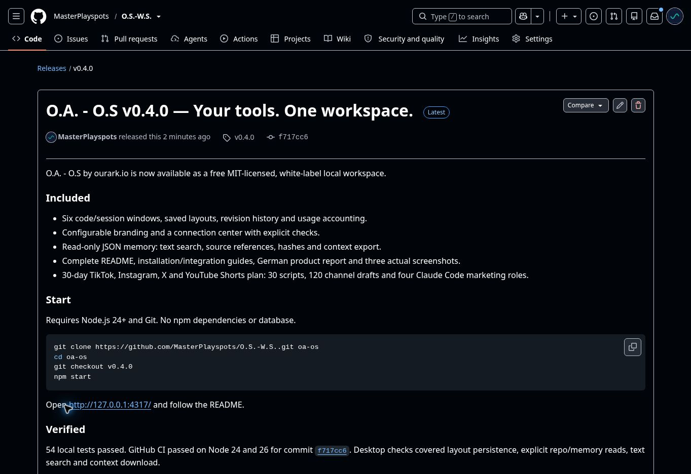

# O.A. - O.S v0.4.0 — publication receipt

Published on 17 November 2026. The repository remains public and MIT licensed.

- Release: https://github.com/MasterPlayspots/O.S.-W.S./releases/tag/v0.4.0
- Release commit: `f717cc63e6151bcf26deea7172abbb873b40c1bc`
- CI: https://github.com/MasterPlayspots/O.S.-W.S./actions/runs/44187450437 — successful on Node 24 and Node 26.
- Local verification: 54 tests passed; see [verification details](VERIFICATION_0.4.md).
- Source ZIP and tar.gz downloads are available on the release page and include the product documentation, examples, marketing handoff and three product screenshots.

The following screenshot records the actual published GitHub release. This receipt and release-page screenshot were added after tagging v0.4.0; the tagged application code is unchanged.

## Remaining operational work

This release is supported as a local single-user workspace. Linux production migration, live cloud connectors, multi-user hosting and social-video production/publication have not been performed. The repository contains the corresponding integration guidance and Claude Code handoffs. Four marketing role definitions are included; running them in the user's Claude Code session remains a next step.
