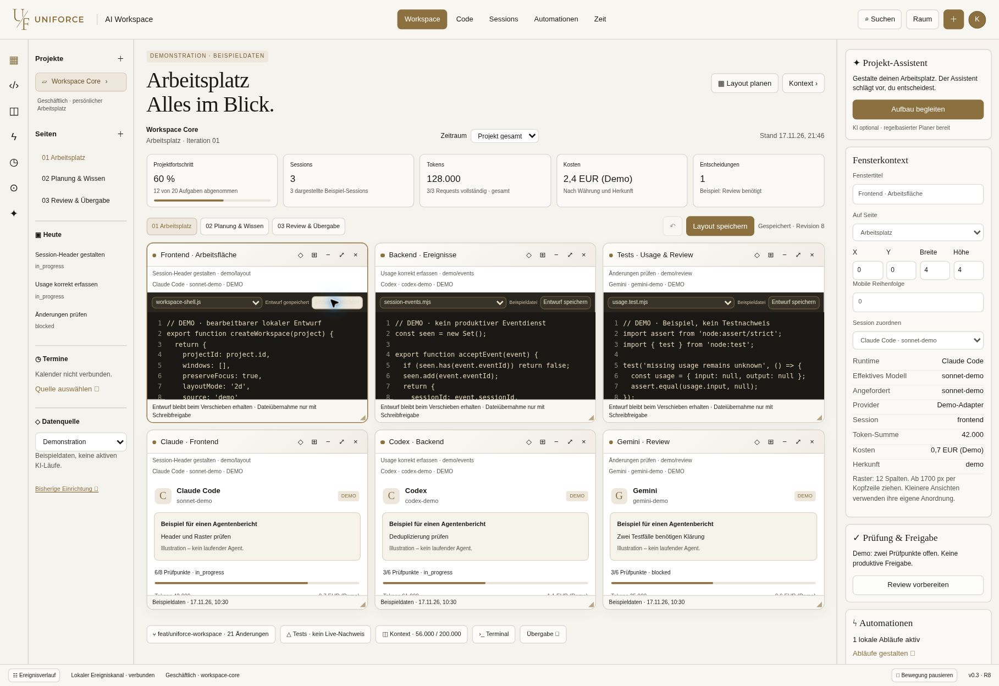

# Prüfstand · 17.11.2026

Basis: `3b82b64a85a1546c495a876443d6eb3f8cd9f499`, Node `24.22.1`. Version 0.3, Zweig `feat/uniforce-workspace`. Prüfergebnis bezieht sich auf den neuen lokalen Entwicklungsstand; keine Produktivabnahme.

| Prüfung | Ergebnis / Beleg |
|---|---|
| Unveränderte Basistests | 26/26 vor Umbau bestanden |
| Gesamte Suite | `npm test`: 47/47 bestanden, kein Skip |
| Authgrenze | Host/Origin/Session; keine Sessionwerte im Event-URL; Legacy-Routen weiter geprüft |
| Speicher | konkurrierende Revisionen → 409; isolierte Projekt-/Privatdateien; gespeicherte Entwürfe und begrenzte Historie |
| Ereignisse | idempotente Wiederholung, Sequenzlücke, geänderte Event-ID, unerlaubte Fähigkeit; echte lokale HTTP-/CLI-Pfade |
| Usage | Snapshotersetzung, Delta-Baseline, terminale Korrektur, unbekannt statt 0, getrennte Währungen/Herkünfte, Zeitfilter |
| Dateiadapter | ausdrückliche Auswahl, verfolgte Dateien, Symlinks/Rootausbruch/erkannte Secrets gesperrt, Basis-Hash-Konflikt |
| Automationen | konkrete Preview-Version und Scope erforderlich, Ein-Schritt-Lokalwirkung, idempotenter Ereignistest |
| Modellvertrag | synthetische CLI: Ausgabe-/Usage-Vertrag, fehlende Modell-ID/Kosten, Cooldown, Timeout und SIGKILL bei ignoriertem SIGTERM |
| Echter Modellstart | CLI/Anmeldung erkannt; interner App-Server meldet Read-only-Dateisystem. **Nicht bestanden / nicht verbunden** |
| UI-Fluss | Entwurf geändert/gespeichert, Fokusfenster vergrößert/zurück, Fokus-/Rastervorschlag übernommen, Layout gespeichert, historischen Entwurf nur lesend geöffnet, aktueller Stand wiederhergestellt |
| Echte Repoquelle | über Verbindungen gelesen; Branch/HEAD und ausgewählte `src/core.mjs` tatsächlich angezeigt |
| Responsive | beobachtet bei 1363 CSS px (zwei Spalten), 1817 CSS px (individuelles Raster), 545 und 340 CSS px (ein Fenster, funktionierender Umschalter), kein horizontaler Seitenüberlauf in diesen Prüfschritten |
| Exakt 1920/1440/1024/390 px | nicht separat automatisiert geprüft; native Browser-DevTools in dieser Umgebung gesperrt, nicht umgangen |
| Safari/iPhone/Gyroskop | nicht geprüft / Gyroskop nicht implementiert |
| Reduced Motion | CSS respektiert die Präferenz, eigener Pausenschalter; Systempräferenz am echten Zielgerät noch prüfen |
| Produktion / Controls / Kalender / Chats | nicht verbunden oder deployed; separate Zielabnahme nötig |

Browser-Konsolenmeldungen der installierten Browser-Erweiterung wurden von Appfehlern unterschieden; sie sind kein erfolgreicher oder fehlgeschlagener App-Backendnachweis. Die sichtbaren Zahlen 60 %, 128.000 Tokens und 2,40 EUR sowie drei Modellnamen stammen ausschließlich aus der bezeichneten Demo-Fixture.

## Bekannte Produktgrenzen

- Native Textfelder statt Monaco/Diffeditor; Dateiübernahme optional, keine PTY-/Sessionsteuerung.
- „Duplizieren“ teilt eine Dateibindung auf zwei Fenster; kein vollständiger Split-/Tabgruppenmanager.
- Kein freies mobiles Größenlayout, keine iPhone-Sensoranbindung, kein WebGL-Renderer.
- Lokal gespeicherte Historie enthält nicht alle externen Dateiversionen oder Terminalzustände.
- Request-/Attempt-IDs werden dedupliziert; providerübergreifende Parent-/Child-Normalisierung muss der Quelladapter liefern.
- `--allow-file-write` nur in eigenem Worktree: externe Dateischreiber können außerhalb der lokalen Warteschlange konkurrieren.
- Limitierte Mustererkennung für Secrets ist keine vollständige DLP-Prüfung. Lokale Quelle muss passend freigegeben sein.
- Kein nachgewiesener finanzieller Kosten-Cap. Modell-Aufruf ist ausdrücklich optional und zeitlich begrenzt.

## Sichtnachweis

Browser-Aufnahme des lokalen Entwicklungsstands; die Zahlen und Modellnamen sind Demonstrationsdaten. Zusätzlich wurde eine lokale Automation nach Vorschau aktiviert und zweimal mit derselben Ereignis-ID getestet: genau ein Reportentwurf.
